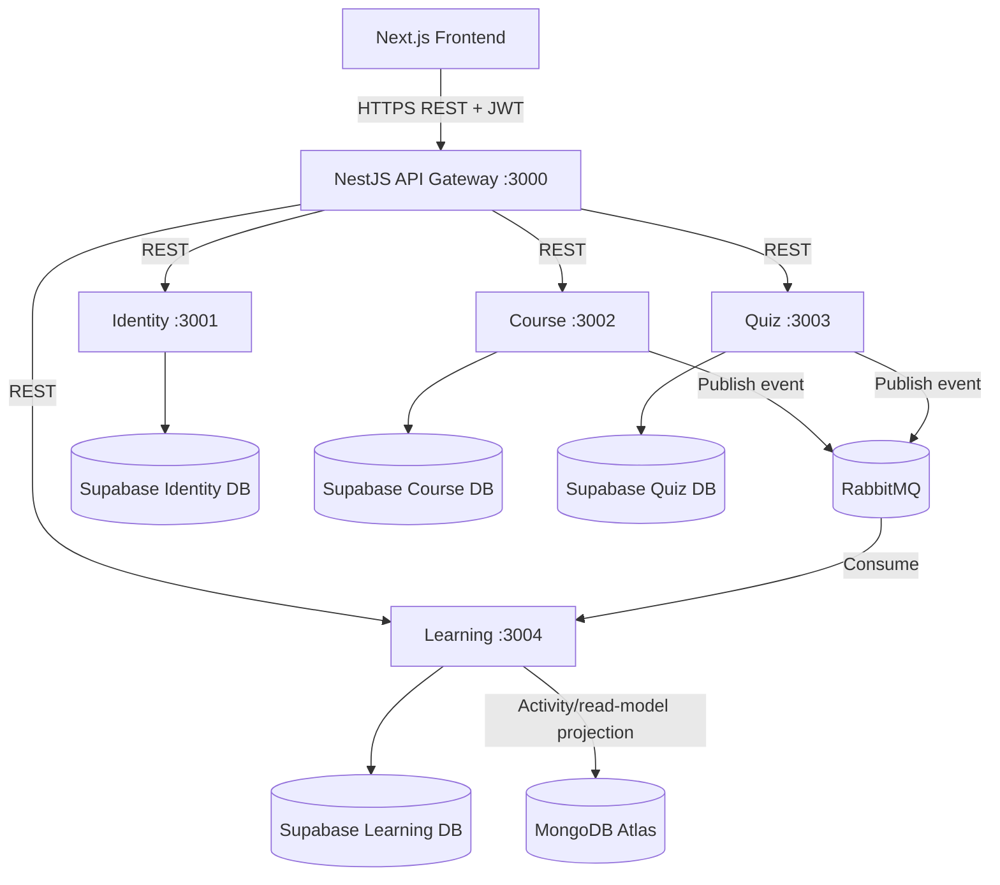
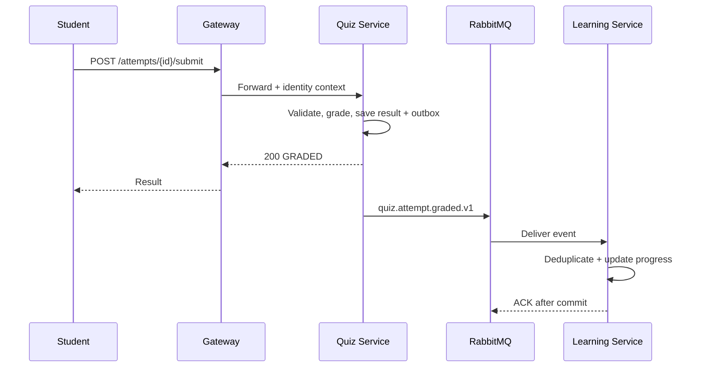

# LMS — Tài liệu phân tích, thiết kế và hướng dẫn triển khai

> **Phiên bản:** 1.0 · **Ngày:** 05/11/2026  
> **Phạm vi:** `lms-backend` (NestJS monorepo), frontend Next.js dự kiến triển khai riêng.  
> **Trạng thái:** Tài liệu thiết kế đề xuất, **không khẳng định các tính năng đã được hiện thực**.

## 0. Cách đọc và nguồn yêu cầu

Tài liệu phân biệt:

- **[Bắt buộc — SOA]**: theo tài liệu *YÊU CẦU BÀI TẬP LỚN — Phát triển phần mềm hướng dịch vụ* mà nhóm cung cấp.
- **[Đã thống nhất]**: lựa chọn kiến trúc/stack được nhóm xác nhận trong quá trình thiết kế.
- **[Đề xuất]**: hợp đồng, quy tắc nghiệp vụ, luồng và cách triển khai mẫu cần nhóm rà soát/chốt trước khi lập trình.
- **[Tùy chọn]**: phần mở rộng, không phải điều kiện để đạt MVP.

**Các điều kiện SOA phải đáp ứng:** nhóm 3–4 người cần **ít nhất 3 business services** (không tính Gateway); mỗi service có mã nguồn và dữ liệu riêng, ≥4 REST endpoints, ≥1 endpoint thể hiện business rule bằng 4xx, file OpenAPI và `GET /health`; API Gateway là điểm vào duy nhất, không chứa nghiệp vụ; các lời gọi liên service phải có timeout/retry và phân biệt 4xx với 503/504; ≥1 luồng xuyên ≥2 services có rollback hoặc PENDING; Dockerfile từng service và một `docker-compose.yml` chạy bằng `docker compose up`; Postman collection ≥10 requests và ≥2 kịch bản lỗi có số liệu. Báo cáo SOA tối thiểu 30 trang, slide tối đa 10. RabbitMQ + consumer idempotent + DLQ, JWT tại Gateway, circuit breaker và CI/log tập trung là **điểm cộng**, không phải yêu cầu bắt buộc.

---

# PHẦN I — PHÂN TÍCH NGHIỆP VỤ

## 1. Bối cảnh và vấn đề

Hệ thống Learning Management System (LMS) hỗ trợ giảng viên xây dựng khóa học, học viên đăng ký học, thực hiện bài kiểm tra, theo dõi tiến độ và nhận gợi ý học tập. Khi quản lý thủ công hoặc sử dụng các công cụ rời rạc, thường xuất hiện các vấn đề: khó kiểm soát quyền truy cập, nội dung phân tán, kết quả đánh giá khó tổng hợp và tiến độ học tập không được cập nhật nhất quán.

**Mục tiêu MVP:** có một luồng hoàn chỉnh: giảng viên tạo và xuất bản khóa học → học viên đăng ký → truy cập bài học → làm quiz → hệ thống chấm điểm → cập nhật tiến độ. Phần đề xuất bài học thích ứng là giai đoạn sau nếu thời gian hạn chế.

## 2. Actors và quyền hạn

| Actor | Nhu cầu | Quyền điển hình |
|---|---|---|
| Guest | Khám phá khóa học công khai | Xem danh mục/chi tiết đã xuất bản |
| Student | Học và đánh giá | Đăng ký, học, nộp quiz, xem kết quả của mình |
| Instructor | Tạo và quản lý nội dung | CRUD khóa học/bài học do mình sở hữu, tạo quiz |
| Admin | Quản trị hệ thống | Quản lý tài khoản, xử lý vi phạm, phân quyền |
| System worker | Đồng bộ sự kiện | Cập nhật progress, gửi thông báo, tính analytics |

**Nguyên tắc:** RBAC kiểm soát vai trò; **ownership** kiểm soát đối tượng cụ thể. Instructor không được sửa khóa học của Instructor khác chỉ vì cùng vai trò.

## 3. Phạm vi chức năng

| Nhóm | MVP (P0) | Mở rộng (P1/P2) | Owner |
|---|---|---|---|
| Identity | Đăng ký, đăng nhập, profile, JWT, roles | Refresh token rotation, audit log | TV1 |
| Course | Tạo khóa học, chương, bài học, publish, enrollment | Q&A, review, search nâng cao | TV2 |
| Quiz | Question bank, quiz, attempt, grading, result | Randomization, analytics đề thi | TV3 |
| Learning | Lesson completion, progress, mastery cơ bản | Adaptive recommendation, certificate | TV4 |
| Gateway | Routing, xác thực, rate limit, correlation ID | Circuit breaker, aggregated docs | Tích hợp chung |
| Frontend | Auth, danh mục, course player, quiz, dashboard | Admin console, advanced analytics | Phân công riêng |

**Ngoài phạm vi MVP:** livestream, thanh toán, chống gian lận nâng cao, AI recommendation bắt buộc, video transcoding, đa tổ chức phức tạp. Nếu backlog thực tế có các mục này, đưa vào phase sau và giữ ưu tiên từ backlog đã duyệt.

**Đối chiếu Function List:** P0/P1 trong bảng là phạm vi MVP kỹ thuật đề xuất, không thay thế backlog môn học/Function List đã duyệt. Chưa có Function List trong nguồn tài liệu hiện tại để xác nhận certificate là tùy chọn. Trước khi giao task, nhóm phải lập mapping `Function ID → yêu cầu → service owner → mức bắt buộc → phase → acceptance test`; chức năng bắt buộc trong Function List vẫn phải triển khai dù nằm ngoài luồng cốt lõi. Certificate và recommendation giữ trạng thái **chờ đối chiếu backlog**, không tự coi đã loại khỏi phạm vi giao nộp.

## 4. Quy tắc nghiệp vụ đề xuất

| ID | Quy tắc | Service sở hữu | HTTP lỗi gợi ý |
|---|---|---|---|
| BR-01 | Email đăng ký không trùng | Identity | `409 EMAIL_ALREADY_EXISTS` |
| BR-02 | Chỉ tài khoản ACTIVE được đăng nhập | Identity | `403 ACCOUNT_INACTIVE` |
| BR-03 | Chỉ Instructor sở hữu khóa học/Admin được chỉnh sửa | Course | `403 NOT_COURSE_OWNER` |
| BR-04 | Chỉ khóa học PUBLISHED mới cho Student đăng ký | Course | `409 COURSE_NOT_PUBLISHED` |
| BR-05 | Không đăng ký cùng khóa học hai lần | Course | `409 ALREADY_ENROLLED` |
| BR-06 | Bài học thuộc đúng chương và khóa học | Course | `422 INVALID_LESSON_RELATION` |
| BR-07 | Chỉ học viên đã đăng ký mới xem nội dung giới hạn | Course | `403 ENROLLMENT_REQUIRED` |
| BR-08 | Quiz phải PUBLISHED và đang trong thời gian cho phép | Quiz | `409 QUIZ_NOT_AVAILABLE` |
| BR-09 | Không vượt quá `maxAttempts` | Quiz | `409 ATTEMPT_LIMIT_REACHED` |
| BR-10 | Không nộp lại attempt đã SUBMITTED | Quiz | `409 ATTEMPT_ALREADY_SUBMITTED` |
| BR-11 | Chỉ người sở hữu attempt xem kết quả cá nhân | Quiz | `403 NOT_ATTEMPT_OWNER` |
| BR-12 | Hoàn thành bài học phải thuộc khóa học đã đăng ký | Learning | `403 ENROLLMENT_REQUIRED` |
| BR-13 | Cập nhật tiến độ không được cộng trùng cùng một sự kiện | Learning | Idempotent consumer |
| BR-14 | Chứng chỉ chỉ cấp khi thỏa điều kiện hoàn thành | Learning | `409 COURSE_NOT_COMPLETED` |
| BR-15 | Practice quiz chỉ phục vụ luyện tập, không góp điều kiện graded assessment; graded quiz tính đạt theo policy snapshot của attempt | Quiz/Learning | `422 INVALID_QUIZ_POLICY` |
| BR-16 | Chỉ hoàn thành course khi enrollment hợp lệ, tất cả learning items bắt buộc hoàn thành và tất cả graded assessments bắt buộc đạt | Learning | `409 COURSE_REQUIREMENTS_NOT_MET` |
| BR-17 | Hoàn thành course không tự động đồng nghĩa đã cấp certificate; eligibility và issuance là bước riêng | Learning | `409 CERTIFICATE_NOT_ELIGIBLE` |
| BR-18 | Resume chỉ đọc/ghi vị trí thuộc course mà user được phép học; checkpoint không tự đánh dấu hoàn thành | Learning | `403 ENROLLMENT_REQUIRED` |

BR-15–18 là **đề xuất domain bổ sung**, cần review cùng Function List; không phải các rule đã được hiện thực trong code.

**Cần chốt trước khi code:** ngưỡng đạt quiz, số lượt làm, điều kiện hoàn thành khóa học, có cho học viên tự hủy enrollment hay không, quiz gắn vào lesson hay course. Các giá trị này không được hard-code vào Gateway.

## 5. Use cases và luồng chính

1. **UC-01 Đăng ký/đăng nhập:** Identity xác thực, phát access token, Gateway xác minh token ở request sau.
2. **UC-02 Xuất bản khóa học:** Instructor tạo course → chapter → lesson → publish; Course kiểm tra ownership và cấu trúc hợp lệ.
3. **UC-03 Enrollment:** Student yêu cầu tham gia → Course kiểm tra course PUBLISHED và chưa đăng ký → lưu enrollment → phát `course.enrollment.created.v1`.
4. **UC-04 Làm quiz:** Student bắt đầu attempt → gửi đáp án → Quiz chấm điểm và lưu kết quả → phát `quiz.attempt.graded.v1`.
5. **UC-05 Tiến độ:** Learning nhận sự kiện hoàn thành bài học hoặc kết quả quiz → cập nhật progress/mastery → trả dashboard.

---

# PHẦN II — KIẾN TRÚC HỆ THỐNG

## 6. Sơ đồ tổng quan



**[Đã thống nhất]** 4 business services + API Gateway; 4 Supabase projects riêng cho dữ liệu nghiệp vụ; TypeORM; monorepo npm workspaces. MongoDB Atlas là datastore phụ trợ cho learning activity, analytics/read model và recommendation features. **[Đề xuất]** RabbitMQ làm event bus cho đồng bộ tiến độ. **Không dùng** một database chung hay foreign key xuyên database.

## 7. Trách nhiệm và quyền sở hữu dữ liệu

| Service | Aggregate/entity chính | Không được làm |
|---|---|---|
| Identity | `User`, `Credential`, `Role`, `Profile` | Lưu điểm quiz hoặc nội dung course |
| Course | `Course`, `Chapter`, `Lesson`, `Enrollment` | Lưu mật khẩu, tự chấm quiz |
| Quiz | `Question`, `Quiz`, `Attempt`, `Answer`, `Result` | Sửa trực tiếp enrollment/progress |
| Learning | `LessonProgress`, `CourseProgress`, `Mastery`, `Certificate` | Đọc trực tiếp DB Quiz/Course |
| Learning projection | `learning_activity_events`, `progress_read_models`, `recommendation_features` trên MongoDB Atlas | Không làm source of truth cho enrollment, grading hoặc credential |

Các service chỉ lưu **ID tham chiếu** (`userId`, `courseId`, `quizId`, `lessonId`), không tạo database-level FK sang service khác. Dữ liệu tham chiếu có thể được xác minh bằng REST hoặc local read model từ event; nếu service nguồn unavailable, xử lý lỗi hạ tầng hoặc PENDING thay vì đoán.

Supabase/PostgreSQL là **source of truth** cho User, Course, Enrollment, Quiz, Attempt, Result và Progress chính thức. MongoDB Atlas chỉ giữ dữ liệu append-only hoặc projection có thể xây dựng lại từ event. Không thực hiện distributed transaction giữa Supabase và Atlas; nếu projection thất bại, consumer retry hoặc rebuild projection sau.

### 7.1 Tại sao không chia theo Controller/Entity?

Phân rã theo **business capability** giúp mỗi service có logic và database độc lập. Nếu chia `user-controller`, `course-controller`, `quiz-controller` nhưng mọi service cùng ghi vào một database thì ranh giới sở hữu dữ liệu yếu, không thể triển khai độc lập an toàn.

### 7.2 Vai trò API Gateway

Gateway thực hiện routing, kiểm tra JWT/signature, coarse-grained policy, rate limit, request ID, timeout, chuyển tiếp lỗi. **Không** tính điểm, quyết định enrollment, cấp chứng chỉ hoặc ghi database nghiệp vụ. Service vẫn phải kiểm tra authorization/ownership phía mình; không tin header `X-User-Id` từ client. Gateway chỉ truyền identity context đã xác thực qua cơ chế nội bộ đáng tin cậy.

## 8. Cấu trúc repository đề xuất

```text
lms-backend/
├── apps/
│   └── api-gateway/
│       ├── src/
│       └── Dockerfile
├── services/
│   ├── identity-service/
│   ├── course-service/
│   ├── quiz-service/
│   └── learning-service/
│       ├── src/
│       │   ├── database/
│       │   ├── health/
│       │   ├── modules/
│       │   ├── common/
│       │   ├── app.module.ts
│       │   └── main.ts
│       ├── test/
│       ├── .env.example
│       └── Dockerfile
├── packages/
│   └── contracts/
│       └── src/
│           ├── http/
│           ├── events/
│           └── index.ts
├── infrastructure/
│   └── rabbitmq/
├── docs/
│   ├── architecture.md
│   ├── contracts.md
│   └── testing.md
├── postman/
├── docker-compose.yml
├── package.json
├── package-lock.json
└── README.md
```

Mỗi service có thể tổ chức module theo feature:

```text
src/modules/courses/
├── dto/
├── entities/
├── courses.controller.ts
├── courses.service.ts
├── courses.repository.ts
└── courses.module.ts
```

**Dependency direction:** Controller → Application Service → Repository/Integration Adapter; Domain không import code nội bộ service khác. `packages/contracts` chỉ chứa DTO/event schema ổn định, **không chứa TypeORM entities, repositories hay secrets**.

## 9. Tech stack và lý do

| Tầng | Công nghệ | Vai trò / lý do |
|---|---|---|
| Frontend | Next.js App Router, React, TypeScript strict | SSR/SSG/ISR, component UI, type safety |
| UI | Tailwind CSS, shadcn/ui/Radix | Responsive, accessibility; lựa chọn đề xuất |
| State/Form | Zustand, TanStack Query, React Hook Form, Zod | Client state, server cache, validation; đề xuất |
| Backend | Node.js LTS, NestJS, TypeScript | DI, modules, guards, interceptors, testing |
| API | REST, OpenAPI/Swagger | Dễ tích hợp và kiểm thử hợp đồng |
| Validation | `class-validator`, `class-transformer` | DTO runtime validation |
| Database | PostgreSQL trên Supabase (4 projects) | ACID, quan hệ dữ liệu, cloud managed |
| ORM | TypeORM + migrations | Data Mapper/Repository, quản lý schema; `synchronize: false` |
| Messaging | RabbitMQ | Đồng bộ bất đồng bộ, retry, DLQ (điểm cộng SOA) |
| Auth | JWT, Passport, Argon2 | Token, strategy, password hashing; cần chốt implementation |
| Security | Helmet, CORS, throttling, RBAC | Hardening, rate limit, phân quyền |
| Testing | Jest, Supertest, RTL, Playwright, Postman | Unit, integration, UI, E2E, API demo |
| Container | Docker, Docker Compose | Chạy toàn hệ thống một lệnh |
| CI | GitHub Actions | Build/test/lint tự động; điểm cộng |
| Observability | Pino, correlation ID, Terminus | Log có cấu trúc, truy vết, health |
| Advanced | Circuit breaker, OpenTelemetry | Tăng độ tin cậy/trace; tùy chọn |
| NoSQL | MongoDB Atlas | Learning activity, analytics/read model, recommendation features và search document; không lưu transaction nghiệp vụ cốt lõi |

**Phân biệt:** package đã cài (`@nestjs/typeorm`, `@nestjs/terminus`...) không chứng minh đã cấu hình kết nối, migrations hay triển khai các tính năng. Không ghi mọi công nghệ là “đã hoàn tất” trong báo cáo.

## 10. Cấu hình và môi trường

| Service | Local port | Env tối thiểu |
|---|---:|---|
| Gateway | 3000 | `PORT`, `IDENTITY_URL`, `COURSE_URL`, `QUIZ_URL`, `LEARNING_URL`, `JWT_PUBLIC_KEY` hoặc JWKS URL |
| Identity | 3001 | `PORT`, `DATABASE_URL`, signing key/config |
| Course | 3002 | `PORT`, `DATABASE_URL`, `RABBITMQ_URL`, `IDENTITY_URL` |
| Quiz | 3003 | `PORT`, `DATABASE_URL`, `RABBITMQ_URL`, `COURSE_URL` |
| Learning | 3004 | `PORT`, `DATABASE_URL`, `RABBITMQ_URL`, `COURSE_URL`, `MONGODB_URI`, `MONGODB_DATABASE` |

**Không commit `.env`**; chỉ commit `.env.example` với placeholder. Dùng Supabase connection string lấy trực tiếp từ dashboard (pooler phù hợp với mạng của nhóm), mã hóa ký tự đặc biệt trong password. Dùng MongoDB Atlas connection string từ Secret/Environment của môi trường, không hard-code vào source. Mỗi thành viên quản lý project Supabase riêng; MongoDB Atlas nên dùng database/collection namespace riêng cho môi trường dev và test.

### 10.1 Database module minh họa

```ts
// src/database/database.module.ts — ví dụ, chưa phải code đã áp dụng
import { Module } from '@nestjs/common';
import { ConfigModule, ConfigService } from '@nestjs/config';
import { TypeOrmModule } from '@nestjs/typeorm';

@Module({
  imports: [
    ConfigModule,
    TypeOrmModule.forRootAsync({
      inject: [ConfigService],
      useFactory: (config: ConfigService) => ({
        type: 'postgres' as const,
        url: config.getOrThrow<string>('DATABASE_URL'),
        autoLoadEntities: true,
        synchronize: false,
        retryAttempts: 5,
        retryDelay: 2000,
        // TLS: cấu hình theo CA/chứng chỉ của môi trường triển khai.
      }),
    }),
  ],
})
export class DatabaseModule {}
```

**Lưu ý:** kiểm tra TLS/certificate theo Supabase connection method; không mặc định `rejectUnauthorized: false` chỉ để vượt lỗi chứng chỉ. Migration được chạy có kiểm soát trước deploy, không dựa vào `synchronize: true`.

---

# PHẦN III — HỢP ĐỒNG GIỮA CÁC SERVICE

## 11. Nguyên tắc contract-first

Trước khi các thành viên code, nhóm cần chốt:

1. Public REST endpoints và request/response DTO.
2. ID format: dùng UUID dạng string xuyên service.
3. Error envelope chuẩn; status code; `requestId`.
4. Event name, schema, version, routing key.
5. Ai publish, ai consume, xử lý trùng/lỗi ra sao.
6. Contract test ở CI; không thay đổi breaking schema mà không bump version.

### 11.1 HTTP response và error envelope

**Thành công:** trả resource trực tiếp hoặc wrapper thống nhất; nhóm nên chọn **một** cách. Đề xuất:

```json
{
  "data": { "id": "c8f0a700-0000-4000-8000-000000000001", "title": "NestJS Basics" },
  "meta": { "requestId": "req-123" }
}
```

**Lỗi:**

```json
{
  "error": {
    "code": "ALREADY_ENROLLED",
    "message": "Student is already enrolled in this course",
    "details": {}
  },
  "requestId": "req-123",
  "timestamp": "2026-11-05T00:00:00.000Z"
}
```

`400` validation; `401` chưa xác thực; `403` không có quyền; `404` không tìm thấy; `409` xung đột trạng thái; `422` dữ liệu hợp lệ về cú pháp nhưng vi phạm quy tắc miền; `503` dependency unavailable; `504` dependency timeout. Không biến mọi lỗi thành `500`.

## 12. REST contract theo service (đề xuất)

> Route hiển thị dưới đây là **public API** qua Gateway, version `/api/v1`. Các service có thể dùng cùng đường dẫn sau khi Gateway loại prefix; cần chốt một quy tắc trước khi viết client.

### 12.1 Identity Service — TV1

| Method | Route | Auth | Ý nghĩa |
|---|---|---|---|
| POST | `/api/v1/auth/register` | Public | Đăng ký |
| POST | `/api/v1/auth/login` | Public | Đăng nhập |
| GET | `/api/v1/users/me` | Student+ | Profile cá nhân |
| PATCH | `/api/v1/users/me` | Student+ | Cập nhật profile |
| GET | `/api/v1/users/:id` | Internal/Admin | Lấy thông tin tối thiểu |
| PATCH | `/api/v1/admin/users/:id/status` | Admin | Khóa/mở tài khoản |

**Login request:** `{ "email": "student@example.test", "password": "<password>" }`. **Login response:** `data.accessToken`, `data.tokenType="Bearer"`, `data.expiresIn`, `data.user {id,email,role}`. Không trả `passwordHash`.

### 12.2 Course Service — TV2

| Method | Route | Auth | Ý nghĩa |
|---|---|---|---|
| POST | `/api/v1/courses` | Instructor | Tạo khóa học |
| GET | `/api/v1/courses` | Public | Danh sách published, phân trang |
| GET | `/api/v1/courses/:id` | Public/Owner | Chi tiết |
| PATCH | `/api/v1/courses/:id` | Owner/Admin | Cập nhật |
| POST | `/api/v1/courses/:id/publish` | Owner/Admin | Xuất bản |
| POST | `/api/v1/courses/:id/enrollments` | Student | Đăng ký học |
| GET | `/api/v1/courses/:id/lessons` | Enrolled/Owner | Danh sách bài học |
| GET | `/api/v1/enrollments/me` | Student | Khóa học đã đăng ký |
| GET | `/api/v1/internal/enrollments/check?userId=...&courseId=...` | Internal | Kiểm tra enrollment |

**Enrollment request:** body `{}` (userId lấy từ identity context, không nhận tùy ý từ client). **Response:** `201` với `enrollmentId, courseId, userId, status, enrolledAt`. Nếu đã đăng ký → `409 ALREADY_ENROLLED`.

### 12.3 Quiz Service — TV3

| Method | Route | Auth | Ý nghĩa |
|---|---|---|---|
| POST | `/api/v1/quizzes` | Instructor | Tạo quiz |
| POST | `/api/v1/quizzes/:id/questions` | Owner | Thêm câu hỏi |
| GET | `/api/v1/quizzes/:id` | Enrolled/Owner | Metadata quiz (không lộ đáp án) |
| POST | `/api/v1/quizzes/:id/attempts` | Student | Bắt đầu lượt làm |
| PUT | `/api/v1/attempts/:id/answers` | Attempt owner | Lưu đáp án |
| POST | `/api/v1/attempts/:id/submit` | Attempt owner | Nộp và chấm |
| GET | `/api/v1/attempts/:id/result` | Attempt owner/Owner | Xem kết quả |

**Submit response:** `200` với `{ attemptId, quizId, score, maxScore, passed, gradedAt }`. Quiz chỉ chấm tự động các câu hỏi khách quan ở MVP; câu tự luận cần trạng thái `PENDING_REVIEW` nếu được bổ sung.

### 12.4 Learning Service — TV4

| Method | Route | Auth | Ý nghĩa |
|---|---|---|---|
| PUT | `/api/v1/learning/lessons/:id/completion` | Student | Đánh dấu hoàn thành |
| GET | `/api/v1/learning/courses/:id/progress` | Enrolled | Tiến độ khóa học |
| GET | `/api/v1/learning/me/dashboard` | Student | Tổng hợp tiến độ |
| GET | `/api/v1/learning/courses/:id/mastery` | Enrolled | Năng lực theo chủ đề |
| GET | `/api/v1/learning/me/recommendations` | Student | Gợi ý bài học |
| POST | `/api/v1/learning/courses/:id/certificate` | Student | Yêu cầu cấp chứng chỉ |

**Completion request:** `{ "completed": true }`. Nên dùng `PUT` vì thao tác có tính idempotent: gọi lại không được cộng số bài đã hoàn thành lần nữa.

### 12.5 Endpoint kỹ thuật bắt buộc

Mỗi business service có `GET /health` kiểm tra khả năng hoạt động (có thể gồm DB) và **đề xuất** thêm `GET /health/live` chỉ kiểm tra process. Mỗi service xuất file `openapi.yaml`/`openapi.json`. Gateway không được thay thế yêu cầu mỗi service có tài liệu riêng.

## 13. Event contract RabbitMQ

### 13.1 Envelope chuẩn

```json
{
  "eventId": "9a1f0000-0000-4000-8000-000000000001",
  "eventType": "quiz.attempt.graded",
  "version": 1,
  "occurredAt": "2026-11-05T08:00:00.000Z",
  "producer": "quiz-service",
  "correlationId": "req-123",
  "payload": {
    "attemptId": "...",
    "quizId": "...",
    "courseId": "...",
    "userId": "...",
    "score": 8,
    "maxScore": 10,
    "passed": true
  }
}
```

**Quy ước:** routing key `quiz.attempt.graded.v1`; exchange `lms.events` loại `topic`; queue riêng cho từng consumer, ví dụ `learning.quiz-results.v1`. Dùng durable queue, persistent messages, manual ack. Không đưa JWT, password hoặc đáp án đúng vào event.

### 13.2 Danh mục events đề xuất

| Routing key | Producer | Consumer | Mục đích |
|---|---|---|---|
| `course.enrollment.created.v1` | Course | Learning | Khởi tạo progress |
| `learning.lesson.completed.v1` | Learning | Analytics/khác (tùy chọn) | Thống kê |
| `quiz.attempt.graded.v1` | Quiz | Learning | Cập nhật mastery/progress |
| `course.published.v1` | Course | Search/Notification (tùy chọn) | Cập nhật read model |
| `learning.course.completed.v1` | Learning | Notification (tùy chọn) | Thông báo hoàn thành |

**Đề xuất chuẩn hóa namespace:** dùng `learning.lesson.completed.v1` cho event do Learning phát sau khi transaction completion commit. Tên cũ `course.lesson.completed.v1` được thay thế trong thiết kế; nếu đã có consumer thực tế, phải lập kế hoạch chuyển đổi routing key, không đổi âm thầm. Contract package hiện chưa khai báo event completion này.

### 13.3 Idempotency và DLQ

Consumer ghi `eventId` vào bảng `processed_events` với UNIQUE constraint. Trong **cùng một database transaction**, kiểm tra/insert eventId và cập nhật progress. Nếu event đã xử lý → ack, không cập nhật lại. Nếu lỗi tạm thời → retry có backoff và giới hạn; vượt ngưỡng → DLQ để kiểm tra. **Không ack trước khi transaction commit**.

**Vấn đề quan trọng:** ghi DB Quiz thành công nhưng publish RabbitMQ thất bại có thể mất event. Giải pháp production là **transactional outbox** (ghi result + outbox row cùng transaction; publisher worker gửi event và đánh dấu đã gửi). MVP có thể triển khai outbox tối giản; nếu không, phải ghi rõ hạn chế và kịch bản phục hồi.

Learning xử lý event theo hai nhánh: cập nhật progress/mastery chính thức trong Supabase/PostgreSQL và ghi activity/projection vào MongoDB Atlas. Nhánh Atlas không được quyết định kết quả nghiệp vụ; phải idempotent theo `eventId`, có retry và có thể rebuild từ event/outbox. Nếu Atlas unavailable, vẫn giữ được progress chính thức và đánh dấu projection cần đồng bộ lại.

## 14. Distributed workflow: Submit quiz → update progress



**Hai trạng thái cần tách:** `QuizResult=GRADED` và `ProgressSync=PENDING|SYNCED|FAILED`. Nếu RabbitMQ hoặc Learning down, **không rollback điểm đã chấm**; giữ event trong outbox/queue và retry. UI có thể hiển thị “Kết quả đã lưu, tiến độ đang đồng bộ”. Nếu một request đồng bộ sang Course để kiểm tra enrollment bị timeout và chưa biết kết quả, attempt có thể chuyển `PENDING_VALIDATION` (cần chốt policy) thay vì tự suy đoán.

**Đáp ứng SOA:** luồng trải qua Quiz + Learning, có trạng thái PENDING khi đồng bộ chưa hoàn tất. Khi demo, phải chứng minh bằng trạng thái thực và log/DB, không chỉ giải thích trên slide.

## 15. Timeout, retry và error propagation

- Gọi nội bộ qua HTTP: timeout đề xuất 1–2 giây trong local demo, đo thực tế rồi điều chỉnh.
- Chỉ retry tự động cho request **an toàn/idempotent**, lỗi mạng hoặc 503/504, số lần giới hạn (ví dụ 2) + exponential backoff/jitter.
- Không retry lỗi 400/401/403/404/409/422.
- POST có side effect phải dùng `Idempotency-Key` hoặc thiết kế chống trùng trước khi retry.
- Gateway trả `503 SERVICE_UNAVAILABLE` khi dependency không thể kết nối; `504 GATEWAY_TIMEOUT` khi quá hạn; không báo `409` cho lỗi hạ tầng.
- Correlation ID được truyền qua Gateway → services → event; log không chứa secrets.

---

# PHẦN IV — MOCK DATA VÀ PHÁT TRIỂN SONG SONG

## 16. Phân biệt 4 loại mock

| Loại | Dùng khi | Ví dụ | Có thay DB thật? |
|---|---|---|---|
| **Seed data** | Cần dữ liệu mẫu để demo/query thật | Users, courses, quizzes, enrollments | Không — ghi vào DB dev/test |
| **HTTP mock server** | Service khác chưa hoàn thành | Quiz giả lập Course `/internal/enrollments/check` | Có, chỉ ở ranh giới HTTP |
| **Event fixture / publisher mock** | RabbitMQ producer chưa sẵn sàng | Publish `quiz.attempt.graded.v1` mẫu | Không — mô phỏng message |
| **Unit test mock** | Test logic cô lập | Mock repository `findOne`, event publisher | Có trong phạm vi test |

**Không dùng một JSON tĩnh làm “database thật” trong bản demo cuối** nếu mục tiêu là chứng minh database riêng, giao dịch, idempotency và fault tolerance.

## 17. Chiến lược ID và tính nhất quán fixture

Dùng UUID **cố định, hợp lệ** cho dataset chung, ví dụ:

```json
{
  "users": {
    "studentA": "11111111-1111-4111-8111-111111111111",
    "instructorA": "22222222-2222-4222-8222-222222222222"
  },
  "courses": {
    "nestjsBasics": "33333333-3333-4333-8333-333333333333"
  },
  "quizzes": {
    "quiz1": "44444444-4444-4444-8444-444444444444"
  }
}
```

Lưu file `packages/contracts/fixtures/ids.json` để mọi thành viên dùng cùng IDs trong **môi trường demo**. Không tạo khóa ngoại xuyên DB; mỗi service chỉ seed các bảng mình sở hữu, có thể giữ ID tham chiếu do fixture định nghĩa. Seed script phải **idempotent** (upsert theo ID hoặc unique key), không nhân bản dữ liệu khi chạy lại.

## 18. Bộ dữ liệu mẫu tối thiểu

| Service | Seed đề xuất | Mục tiêu kiểm thử |
|---|---|---|
| Identity | 1 Admin, 1 Instructor, 2 Students | Auth, RBAC, ownership |
| Course | 2 Courses (1 PUBLISHED, 1 DRAFT), 2 Chapters, 4 Lessons, 1 Enrollment | Browse, publish, enrollment conflict |
| Quiz | 1 published quiz, 3 multiple-choice questions, 1 submitted attempt | Chấm điểm, max attempts, result privacy |
| Learning | 1 progress chưa hoàn tất, 1 completed lesson, 1 processed event | Tính progress, chống event trùng |

Mọi email dùng domain ví dụ `example.test`; password demo không dùng chung với tài khoản thật. Hash password bằng thuật toán thực tế của Identity; **không seed plaintext password** vào database.

## 19. Mock HTTP service với NestJS

Ví dụ **Quiz Service cần kiểm tra enrollment từ Course**, nhưng Course chưa triển khai. Tạo adapter để thay implementation bằng cấu hình:

```ts
// services/quiz-service/src/integrations/enrollment.port.ts
export interface EnrollmentPort {
  isEnrolled(userId: string, courseId: string): Promise<boolean>;
}
export const ENROLLMENT_PORT = Symbol('ENROLLMENT_PORT');
```

```ts
// services/quiz-service/src/integrations/mock-enrollment.adapter.ts
import { Injectable } from '@nestjs/common';
import { EnrollmentPort } from './enrollment.port';

@Injectable()
export class MockEnrollmentAdapter implements EnrollmentPort {
  async isEnrolled(userId: string, courseId: string): Promise<boolean> {
    return userId === '11111111-1111-4111-8111-111111111111'
      && courseId === '33333333-3333-4333-8333-333333333333';
  }
}
```

```ts
// services/quiz-service/src/integrations/enrollment.module.ts
import { Module } from '@nestjs/common';
import { ENROLLMENT_PORT } from './enrollment.port';
import { MockEnrollmentAdapter } from './mock-enrollment.adapter';
import { HttpEnrollmentAdapter } from './http-enrollment.adapter';

@Module({
  providers: [{
    provide: ENROLLMENT_PORT,
    useClass: process.env.MOCK_COURSE === 'true'
      ? MockEnrollmentAdapter
      : HttpEnrollmentAdapter,
  }],
  exports: [ENROLLMENT_PORT],
})
export class EnrollmentModule {}
```

`HttpEnrollmentAdapter` là adapter thật cần implement theo contract, có timeout, internal authentication và mapping 4xx/503/504. Trong test hoặc local dev có thể `MOCK_COURSE=true`; **production phải mặc định false**, không để mock cho phép mọi user truy cập.

**Tốt hơn mock bằng `true` vô điều kiện:** mock cần mô phỏng cả các trường hợp `enrolled`, `not enrolled`, `course not found`, `timeout`, `503` để test đúng nhánh lỗi.

## 20. Mock event RabbitMQ

Tạo fixture JSON cho event `quiz.attempt.graded.v1`, sau đó dùng script dev publisher gửi đến exchange/routing key giống production. Đặt `eventId` cố định cho bài test trùng event; với bài test nhiều event khác nhau, tạo UUID mới. Kịch bản bắt buộc:

1. Gửi event hợp lệ → Learning tăng progress một lần.
2. Gửi **lại cùng eventId** → progress không đổi.
3. Gửi payload sai schema → reject/DLQ, không crash consumer.
4. Tắt Learning → message tồn tại trong queue, bật lại → được xử lý.
5. Tắt RabbitMQ khi Quiz chấm điểm → kết quả đã lưu, outbox chờ phát lại.

**Không** publish trực tiếp từ frontend; publisher test là script nội bộ/dev tool.

## 21. Unit test mocks

```ts
// Ví dụ Jest: mock repository, không cần Supabase thật
const repository = {
  findOne: jest.fn().mockResolvedValue(null),
  save: jest.fn(),
};

// Test một rule cụ thể: enrollment trùng -> ConflictException
// Dùng dependency injection để thay repository/port thật bằng mock.
```

**Ranh giới:** unit test mock chứng minh logic nhánh; integration test phải dùng DB test thật (hoặc PostgreSQL container) để kiểm tra migration, unique constraints và transactions. Contract tests phải chạy cùng OpenAPI/event schema, tránh “mock đúng nhưng service thật sai”.

## 22. Quy trình mock → tích hợp thật

1. Hai bên thống nhất OpenAPI/event schema, tạo fixture chung.
2. Consumer implement `Port` và mock adapter, viết test theo contract.
3. Producer implement endpoint/event thật, export OpenAPI.
4. Chạy consumer contract test với producer thật trong môi trường test.
5. Đổi `MOCK_COURSE=false`, cấu hình URL thật, chạy E2E.
6. Kiểm tra timeout, unauthorized, 404, 409, 503, 504.
7. Xóa mọi bypass/mock flag khỏi deployment production và demo cuối (trừ seed dữ liệu mẫu đã ghi DB thật).

---

# PHẦN V — TRIỂN KHAI, KIỂM THỬ, PHÂN CÔNG

## 23. Hướng dẫn khởi chạy và Docker

**Local development:** mỗi thành viên chạy service riêng bằng npm workspace; RabbitMQ có thể chạy Docker Compose riêng, PostgreSQL dùng Supabase cloud.

```powershell
npm install
npm run build
npm run test
npm run start:dev -w @lms/identity-service
# Tương tự: @lms/course-service, @lms/quiz-service, @lms/learning-service
```

Lệnh `start:dev` phụ thuộc scripts thực tế trong từng `package.json`; nếu khác, dùng đúng script đã định nghĩa. Không chạy tất cả bằng một terminal khi chưa cấu hình concurrently.

**Docker Compose cuối kỳ:** 1 `docker-compose.yml` ở root, định nghĩa `gateway`, `identity`, `course`, `quiz`, `learning`, `rabbitmq`. Mỗi service **có Dockerfile riêng**, không phải mỗi thành viên có Docker riêng. Supabase không cần container PostgreSQL. Compose cần healthchecks, service URLs theo DNS tên service (`http://course:3002`, không dùng `localhost` giữa containers), env vars/secrets, ports công khai chỉ ở Gateway khi có thể.

```bash
docker compose up --build
```

`depends_on` không đảm bảo ứng dụng dependency đã sẵn sàng nếu không có health condition; app phải có retry kết nối lúc startup. Không đóng gói `.env`/credential vào Docker image.

## 24. Kiểm thử bắt buộc và fault injection

### 24.1 Postman collection (tối thiểu 10 requests)

| # | Request | Kỳ vọng |
|---:|---|---|
| 1 | Register Student | 201 |
| 2 | Register trùng email | 409 |
| 3 | Login | 200 + JWT |
| 4 | GET `/users/me` không token | 401 |
| 5 | Instructor tạo course | 201 |
| 6 | Student sửa course không sở hữu | 403 |
| 7 | Publish course | 200 |
| 8 | Enroll course | 201 |
| 9 | Enroll lần hai | 409 |
| 10 | Start quiz attempt | 201 |
| 11 | Submit quiz | 200 + result |
| 12 | GET progress | 200; cập nhật sau event |
| 13 | Submit attempt lần hai | 409 |
| 14 | GET `/health` từng service | 200 hoặc 503 khi dependency lỗi |

### 24.2 Fault scenario A — Learning down

- Baseline: submit quiz → result được lưu, progress cập nhật.
- Tắt Learning container, submit quiz mới → Quiz vẫn lưu result; event chờ xử lý, `ProgressSync=PENDING`.
- Khởi động Learning → consume lại; progress cập nhật đúng một lần.
- Ghi số liệu: thời gian submit, thời gian queue tồn, thời gian sync sau recovery, số lần delivery.

### 24.3 Fault scenario B — Course chậm/down

- Baseline: Quiz kiểm tra enrollment qua Course trong ngưỡng latency chấp nhận.
- Inject delay lớn hơn timeout hoặc tắt Course.
- Quiz trả `504` khi timeout hoặc `503` khi unavailable, không tạo attempt không hợp lệ.
- Ghi số liệu: p50/p95 latency, timeout cấu hình, tỷ lệ 503/504, số request thành công/thất bại.

**Không tự bịa kết quả đo:** báo cáo chỉ điền số liệu sau khi thực sự chạy kịch bản. Để dễ demo, có thể tạo cờ delay/failure chỉ bật ở môi trường test, không expose công khai.

## 25. Phân công 4 thành viên

| Thành viên | Chịu trách nhiệm chính | Deliverables |
|---|---|---|
| TV1 | Identity | Entities/migrations, Auth/RBAC, OpenAPI, Dockerfile, tests |
| TV2 | Course | Courses/lessons/enrollment, event publish, OpenAPI, Dockerfile, tests |
| TV3 | Quiz | Questions/attempt/grading, event/outbox, OpenAPI, Dockerfile, tests |
| TV4 | Learning | Progress/mastery trên Supabase, MongoDB Atlas activity/read model, event consumer/idempotency, OpenAPI, Dockerfile, tests |
| Cả nhóm | Gateway, shared contracts, Compose, E2E, báo cáo | PR review, fault demos, integration |

Mỗi thành viên cần giải thích được thiết kế, mã nguồn và trade-offs của phần mình phụ trách khi vấn đáp. Chốt owner của Gateway/Compose cụ thể trong bảng phân công thực tế; “cả nhóm” không có nghĩa không ai chịu trách nhiệm.

## 26. Quy trình Git và tích hợp

- Nhánh `main` được bảo vệ; mỗi feature có branch `feat/<service>/<task>`.
- PR phải có: mô tả, API/event changes, migration, tests, `.env.example` nếu có biến mới.
- Shared contracts thay đổi qua PR và thông báo consumer; không âm thầm đổi field/type.
- CI tối thiểu: install → lint/typecheck → unit tests → build; integration/contract tests khi môi trường sẵn sàng.
- Không commit secrets, database URLs, JWT signing keys hoặc token thật.

## 27. Roadmap đề xuất

| Phase | Công việc | Điều kiện hoàn tất |
|---|---|---|
| 1 — Foundation | Monorepo, package names, shared lint/test, health | 5 apps build, health endpoint hoạt động |
| 2 — Persistence | 4 Supabase projects, TypeORM, migrations, seed | CRUD DB và health DB test pass |
| 3 — Contracts | OpenAPI, DTO, event schema, error envelope | 4 nhóm review và chốt contracts |
| 4 — Core business | Identity/Course/Quiz/Learning | ≥4 endpoints/service, business rule tests |
| 5 — Integration | Gateway, JWT, HTTP adapters, RabbitMQ, outbox, MongoDB Atlas projection | Quiz→Learning sync + idempotency + activity projection |
| 6 — Reliability | Timeout/retry, PENDING, DLQ, fault injection, projection rebuild | 2 scenarios có số liệu; Atlas projection không làm mất progress chính thức |
| 7 — Delivery | Dockerfiles, Compose, Postman, CI, docs | `docker compose up --build` demo thành công |
| 8 — Defense | Báo cáo, slide, tập vấn đáp | Mỗi thành viên giải thích phần mình |

## 28. Checklist nghiệm thu

- [ ] Có ≥3 business services cho nhóm 4 người (thiết kế hiện có 4).
- [ ] Mỗi service sở hữu code/data, có ≥4 REST endpoints và ≥1 rule trả 4xx.
- [ ] Mỗi service có OpenAPI riêng và `GET /health`.
- [ ] Gateway chỉ routing/policy, không chứa business logic.
- [ ] HTTP liên service có timeout, retry policy, 4xx/503/504 rõ ràng.
- [ ] Có ít nhất một luồng qua ≥2 services với rollback hoặc PENDING thực tế.
- [ ] Mỗi service có Dockerfile; một Compose chạy toàn bộ bằng một lệnh.
- [ ] Postman collection ≥10 requests, gồm positive và negative cases.
- [ ] Hai fault scenarios được chạy, đo và ghi số liệu.
- [ ] Báo cáo PDF ≥30 trang; slide ≤10; demo trên máy nhóm.
- [ ] Khai báo việc sử dụng AI trong báo cáo theo quy định môn học.
- [ ] Tất cả thành viên hiểu code, data ownership, contract và cách khôi phục lỗi.

## 29. Quyết định kiến trúc còn cần chốt (ADR backlog)

Các đề xuất chi tiết ở mục 30–33 chưa được xem là quyết định đã duyệt. Chỉ triển khai module phụ thuộc sau khi owner liên quan xác nhận ADR và cập nhật contracts/tests cùng PR.

1. Quiz thuộc course hay lesson? Có quiz bắt buộc để hoàn thành course không?
2. Quiz pass threshold, maxAttempts và grading policy?
3. Progress calculation: tỷ trọng lesson vs quiz; có cho reset không?
4. Identity token: shared symmetric secret hay asymmetric signing/JWKS? Khuyến nghị asymmetric cho nhiều services.
5. Internal service authentication: mTLS, service JWT hoặc network isolation + signed context?
6. RabbitMQ bắt buộc cho MVP hay đưa vào bonus phase? Nếu dùng, có outbox và DLQ đến mức nào?
7. Certificate và recommendation có thuộc MVP không?
8. Frontend dùng state management gì trong số lựa chọn đã đề xuất?
9. Phương thức Supabase pooling/TLS và cơ chế migration khi deploy?
10. Chốt số liệu SLA demo (timeout, retry, latency) sau khi benchmark.
11. MongoDB Atlas dùng cho những projection nào, namespace dev/test ra sao, và cơ chế retry/rebuild khi Atlas unavailable?

---

## 30. Domain Model & Learning Item Model — đề xuất review

Giữ 4 business services, không thêm microservice. Đề xuất quan hệ `Course → Chapter → Lesson → LearningItem`; mỗi lesson chứa các item có thứ tự, `type = VIDEO | READING | QUIZ`, cờ `required` và `contentVersion`. Course sở hữu cấu trúc/content reference; Quiz sở hữu định nghĩa câu hỏi, policy và attempts. Item loại QUIZ chỉ tham chiếu `quizId`, không copy đáp án hoặc grading logic sang Course.

Enrollment ghi nhận một phiên bản requirements đã publish. Learning đọc snapshot requirements gồm item IDs, required flags, graded assessment references và version; không suy luận course completed chỉ từ số phần trăm. Cần xác minh quan hệ quiz/item bằng API/event đã thống nhất, không join DB xuyên service. Việc sửa nội dung tạo version mới; không âm thầm làm mất trạng thái hoàn thành của enrollment cũ. Chính sách migrate enrollment sang version mới cần ADR riêng.

## 31. Course Completion Policy — đề xuất review

- Practice quiz: phản hồi luyện tập; không góp vào điều kiện đạt graded assessment bắt buộc. Nếu practice item là required, tiêu chí hoàn thành item phải được định nghĩa riêng (ví dụ submitted), không đánh đồng với passed.
- Graded quiz: policy gồm `quizType`, `passingScorePercent` trong `[0,100]`, `maxAttempts` là số nguyên dương và `requiredForCompletion`. Đề xuất lấy kết quả đạt của bất kỳ attempt hợp lệ nào trên cùng assessment version; không lấy practice score thay graded score.
- `passed = score / maxScore * 100 >= passingScorePercent`, với `maxScore > 0`; quy tắc làm tròn hiển thị không thay đổi phép so sánh. Attempt snapshot policy và assessment version để thay threshold sau này không đổi kết quả lịch sử.
- Course `COMPLETED` khi enrollment hợp lệ **AND** mọi required item hoàn thành **AND** mọi required graded assessment đạt. Item optional không chặn hoàn thành; course không có requirements bắt buộc phải bị chặn publish hoặc có policy riêng được chốt, không tự hoàn thành bằng phép kiểm tra tập rỗng.
- Learning sở hữu quyết định completion; Course sở hữu enrollment và requirements. Certificate eligibility kiểm tra course completed cùng policy cấp chứng chỉ riêng; issuance có unique constraint/idempotency, không cấp trùng. Practice/graded không quy định cứng số lần làm; giới hạn theo policy đã validate.

**API cần bổ sung ở §12.3:** đề xuất `PATCH /api/v1/quizzes/:id` cho Owner/Admin cập nhật draft policy. DTO runtime phải validate enum, range, integer và quan hệ policy; publish đóng băng version. Không cho client tự truyền điểm, `passed` hoặc tự đặt `requiredForCompletion` trái requirements Course. Event graded cần thêm assessment/policy version trước khi Learning sử dụng policy mới; đó là thay đổi contract cần review compatibility, chưa có trong code hiện tại.

## 32. Learning Resume & Progress State Machine — đề xuất review

### 32.1 Resume Learning

Đề xuất bổ sung §12.4:

| Method | Route qua Gateway | Ý nghĩa |
|---|---|---|
| GET | `/api/v1/learning/courses/:id/resume` | Lấy checkpoint gần nhất của user hiện tại |
| PUT | `/api/v1/learning/courses/:id/resume` | Lưu checkpoint sau validation quyền học và content version |
| GET | `/api/v1/learning/attempts/:attemptId/sync` | Đọc trạng thái projection Quiz → Learning |

Resume resource gồm `courseId`, `lessonId`, `learningItemId`, `contentVersion`, `positionSeconds` (video), `updatedAt`, `revision`. Không có checkpoint trả `data: null`; client có thể chọn item được phép học đầu tiên. Server lấy `userId` từ identity context, kiểm tra checkpoint thuộc đúng course. Dùng revision/optimistic concurrency để checkpoint cũ không ghi đè checkpoint mới; không lấy video position lớn nhất vì user có thể chủ động xem lại. Checkpoint không phải bằng chứng hoàn thành; completion endpoint vẫn có policy riêng.

### 32.2 Completion và đồng bộ

Item: `NOT_STARTED → IN_PROGRESS → COMPLETED`. Course: `NOT_STARTED → IN_PROGRESS → COMPLETED` theo requirements snapshot; reset/reopen phải có policy riêng. Event trùng không cập nhật hai lần; event đến trễ không làm giảm progress hoặc ghi đè assessment version khác. Checkpoint và completion được lưu riêng trong Learning PostgreSQL.

Quiz sở hữu kết quả chấm (`GRADED`) và trạng thái outbox delivery; Learning sở hữu **projection receipt** theo `eventId/attemptId/userId`. Không coi outbox SENT là ProgressSync SYNCED, và không coi việc chưa thấy receipt là đã xử lý thất bại.

- `PENDING`: chưa có receipt terminal hoặc đang retry; API phải kiểm tra attempt tồn tại/ownership qua Quiz (timeout → 503/504, không suy đoán). Có thể biểu diễn pending suy ra khi event chưa tới, không khẳng định Learning đã có row từ lúc Quiz chấm.
- `SYNCED`: transaction Learning đã ghi `processed_events`, progress/mastery và receipt thành công. Receipt cần lưu bền vững ở PostgreSQL; trả `eventId`, `attemptId`, `status`, `updatedAt` và lỗi công khai nếu có.
- `FAILED`: retry đã hết và có failure receipt được ghi bền vững bởi Learning retry/DLQ handler. Chỉ đưa vào broker DLQ không tự cập nhật DB; nếu handler chưa ghi được failure receipt, API vẫn báo pending/unknown kèm trạng thái chẩn đoán, không bịa FAILED.
- Replay được phép `FAILED → PENDING → SYNCED` sau khi sửa lỗi; giữ cùng event identity để deduplicate. ACK chỉ sau commit. Nếu crash giữa ghi failure receipt và đưa DLQ, cần cơ chế retry/outbox để không mất thông tin.

Frontend đọc Quiz result riêng và poll sync endpoint qua Gateway với backoff giới hạn; chỉ hỏi tiến độ của chính user. Atlas projection là trạng thái phụ trợ khác, không quyết định receipt SYNCED của progress chính thức. Cần thống nhất retention/replay source, timeout hiển thị và phân biệt pending với missing attempt trong contract review.

## 33. ADR review register

| ADR | Nội dung cần chốt | Owner review | Trạng thái và tác động |
|---|---|---|---|
| ADR-01 | LearningItem liên kết Quiz, requirements/content version | TV2 + TV3 + TV4 | Đề xuất §30; ảnh hưởng Course/Quiz/Learning schemas |
| ADR-02 | Practice/graded, threshold, attempt policy, completion, certificate eligibility | TV2 + TV3 + TV4 | Đề xuất §31; đối chiếu Function List trước khi duyệt |
| ADR-03 | Resume revision và checkpoint validation | TV2 + TV4 | Đề xuất §32; thêm HTTP DTO/OpenAPI |
| ADR-04 | Receipt ownership, sync query, retry/DLQ/replay | TV3 + TV4 + Gateway owner | Đề xuất §32; thêm status contract và event version metadata |
| ADR-05 | Mapping Function List → MVP/P0/P1 | Trưởng nhóm + cả nhóm | Chờ nguồn Function List; chưa xác nhận certificate tùy chọn |

Mỗi ADR khi duyệt phải bổ sung ngày, người xác nhận, lựa chọn và trade-offs, acceptance tests, migration/versioning plan và PR liên quan. Không ghi tên/ngày phê duyệt khi chưa có xác nhận thực tế. Tech stack và ranh giới 4 services không thay đổi trong đợt chỉnh lý này.

## Phụ lục A — Contract ownership matrix

| Contract | Producer/owner | Consumer | Artifact |
|---|---|---|---|
| Auth JWT claims | Identity | Gateway, services | `contracts/http/auth.ts` + security scheme OpenAPI |
| Enrollment check | Course | Quiz, Learning | `contracts/http/enrollment.ts` |
| Quiz result | Quiz | Learning, Frontend | `contracts/http/quiz-result.ts` |
| Enrollment created event | Course | Learning | `contracts/events/enrollment-created.v1.ts` |
| Attempt graded event | Quiz | Learning | `contracts/events/attempt-graded.v1.ts` |
| Error envelope | Shared | Tất cả | `contracts/http/error.ts` |

**Nguyên tắc versioning:** thêm optional field có thể backward-compatible; xóa/đổi tên field, đổi kiểu hoặc đổi ý nghĩa cần version mới và kế hoạch migrate consumers.

## Phụ lục B — Definition of Done cho một service

Một service được coi là hoàn thành khi: (1) migrations + seed dev; (2) API đáp ứng OpenAPI; (3) DTO validation; (4) authorization + ownership; (5) business rule tests; (6) health; (7) logs + requestId; (8) Dockerfile; (9) fault handling; (10) không truy cập DB của service khác; (11) có README và `.env.example`; (12) tích hợp với consumer thật qua contract test.
