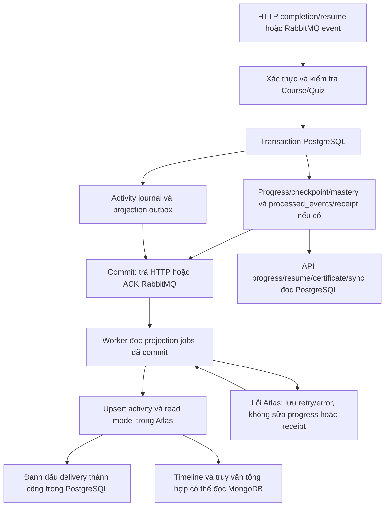

# Learning Service — Hướng dẫn TV4 nhận việc

Owner: chưa chốt tên. Workspace `@lms/learning-service`, port mặc định 3004, branch hiện có `feat/learning/progress`. Theo [README nhận việc](../../README.md) và đọc [AGENTS.md](AGENTS.md) trước khi sửa.

## Trạng thái và phạm vi

Hiện chỉ có scaffold `GET /` → `Hello World!`; chưa có progress API, consumer, receipt hoặc DB. Learning sở hữu progress/resume/mastery/certificate và processed_events/receipts trong PostgreSQL riêng. MongoDB Atlas chỉ cho activity/read model phụ trợ, không quyết định completion hay SYNCED.

Course sở hữu cấu trúc/requirements/enrollment; Quiz sở hữu câu hỏi và kết quả chấm. Learning không tự tạo danh sách required lessons hoặc chấm lại quiz.

## Contracts phải đọc

| Nguồn                                                                                                                                                | Mục đích                                                       |
| ---------------------------------------------------------------------------------------------------------------------------------------------------- | -------------------------------------------------------------- |
| [Learning DTO](../../packages/contracts/src/http/learning.ts)                                                                                        | Progress/resume/dashboard, receipt, mastery/certificate        |
| [Course policy](../../packages/contracts/src/http/course.ts)                                                                                         | Immutable requirements theo contentVersion                     |
| [Internal DTO](../../packages/contracts/src/internal/integration.ts)                                                                                 | Structure, access, graded summary và attempt access            |
| [Enrollment v2](../../packages/contracts/src/events/enrollment-created.v2.ts), [graded v2](../../packages/contracts/src/events/attempt-graded.v2.ts) | Khởi tạo/cập nhật theo version                                 |
| [Domain events](../../packages/contracts/src/events/domain-events.ts)                                                                                | Completion/certificate events tùy consumer                     |
| [Learning OpenAPI](../../packages/contracts/openapi/learning.json)                                                                                   | HTTP catalog đầy đủ                                            |
| [Baseline](../../packages/contracts/README.md)                                                                                                       | Completion, receipt, retry/DLQ/replay và thuật toán cần review |

API: item/lesson completion; lesson/course progress; resume; dashboard/mastery/recommendations; certificates; owner statistics/learner summaries; sync receipt và internal learner progress. Không thay percent progress bằng kết luận course completed.

## Mục tiêu và cách thực hiện

Xây dựng backend theo dõi học tập, tiếp tục bài đang học, xác định hoàn thành và cấp chứng chỉ theo policy. Thực hiện sáu giai đoạn, kiểm thử từng bước trước khi chuyển tiếp. Khi provider chưa sẵn sàng, dùng fake adapter đúng contracts trong test và ghi rõ phần chưa tích hợp thật.

### Giai đoạn 1 — Chuẩn bị hệ thống và dữ liệu tiến độ

**Mục tiêu:** Có nơi lưu trạng thái học tập chính thức và cơ chế xử lý event an toàn.

**Công việc cụ thể:**

1. Triển khai config validation, PostgreSQL connection/migrations, health và kiểm tra user/service credentials.
2. Thiết kế progress theo enrollment/contentVersion, checkpoint có revision, certificate unique theo enrollment/version.
3. Tạo processed_events và receipts; chuẩn bị transaction cập nhật cùng progress.
4. Chuẩn bị kết nối Atlas bằng MongoDB Native Driver, collections/indexes và projection outbox theo mục kiến trúc bên dưới. Thiết kế cả hai DB ngay từ đầu, chưa cần triển khai toàn bộ truy vấn dashboard.

**Giải thích thuật ngữ:** Migration thay đổi bảng; checkpoint là vị trí học gần nhất; revision phát hiện cập nhật cũ; processed_events lưu event đã xử lý; receipt ghi trạng thái đồng bộ; transaction làm các thay đổi cùng thành công hoặc cùng hủy.

**Kết quả cần đạt:** PostgreSQL schema có ràng buộc chống trùng; có Atlas connection lifecycle, index setup và thiết kế đồng bộ. Health phân biệt PostgreSQL không sẵn sàng với MongoDB degraded; PostgreSQL là nguồn progress chính thức.

**Cách kiểm thử:** DB test mới chạy được migrations; config thiếu/DB lỗi được phát hiện; DB từ chối processed_event/certificate trùng. Thử rollback transaction để xác nhận không ghi receipt thành công khi progress chưa commit.

Kiểm tra Atlas ping/index setup khi kết nối được; khi Atlas mất mạng, service báo degraded và các API dùng PostgreSQL vẫn hoạt động. Cấu hình MongoDB sai/thiếu phải được phát hiện, không âm thầm bỏ integration.

### Giai đoạn 2 — Kết nối Course và Quiz

**Mục tiêu:** Learning sử dụng đúng cấu trúc, điều kiện học và kết quả đánh giá từ service sở hữu dữ liệu.

**Công việc cụ thể:**

1. Viết Course adapters đọc enrollment/access và learning structure/completion policy theo contentVersion.
2. Viết Quiz adapters đọc graded summary và attempt access để xác minh user/version/event identity.
3. Kiểm tra dữ liệu trả về qua contracts, đặt timeout và phân biệt not-found, denied, unavailable.
4. Thống nhất luồng kiểm tra học tuần tự với Course, tránh hai API gọi vòng nhau.
5. Chốt nguồn activity: chỉ ghi hành động đã được Learning xác thực và commit, hoặc kết quả Quiz đã xử lý thành công; không coi request đến/client telemetry là bằng chứng hoàn thành. Liệt kê payload projection tối thiểu cùng version.

**Giải thích thuật ngữ:** Adapter kết nối provider; immutable snapshot là cấu trúc đã chốt không bị sửa; timeout giới hạn thời gian chờ; service credential xác thực service gọi nội bộ.

**Kết quả cần đạt:** Có thể lấy metadata cần thiết mà không join DB hoặc đoán version từ fixture IDs; có fake adapter trong test nếu provider chưa xong.

**Cách kiểm thử:** Course/policy khác version, attempt của user khác, token sai scope, provider 404/timeout/unavailable và payload sai schema. Không biến dependency lỗi thành cho phép học hoặc course completed.

### Giai đoạn 3 — Nhận đăng ký và khởi tạo tiến độ

**Mục tiêu:** Mỗi enrollment được khởi tạo progress một lần theo đúng requirements snapshot.

**Công việc cụ thể:**

1. Tạo queue/consumer cho course.enrollment.created.v2; đọc pinned contentVersion và lấy structure đúng version.
2. Ghi processed_events cùng dữ liệu khởi tạo progress trong transaction.
3. ACK sau commit; xử lý event lặp và cancellation theo baseline, giữ lịch sử học tập.
4. Trong transaction khởi tạo/cancel enrollment, ghi activity journal và projection job để worker tạo/cập nhật MongoDB read model. ACK RabbitMQ không chờ MongoDB.

**Giải thích thuật ngữ:** Queue là hàng đợi event; consumer xử lý event; ACK xác nhận đã xử lý cho broker; deduplication ngăn áp dụng event trùng; pin version giữ requirements của lần đăng ký.

**Kết quả cần đạt:** Nhận enrollment v2 tạo progress đúng user/course/version; gửi lại không tạo thêm dữ liệu hoặc reset tiến độ.

**Cách kiểm thử:** Gửi một event nhiều lần, rollback giữa các bước, consumer khởi động lại và snapshot provider không có. Thử cancellation/event đến trễ; xác nhận không xóa lịch sử hoặc mở lại quyền học trái policy.

### Giai đoạn 4 — Progress, completion của item/lesson và resume

**Mục tiêu:** Học viên xem tiến độ, hoàn thành nội dung hợp lệ và tiếp tục đúng vị trí đang học.

**Công việc cụ thể:**

1. Viết đọc item/lesson/course progress và completion theo enrollment/sequence policy.
2. VIDEO/READING xác nhận theo baseline; không cho client tự đánh dấu QUIZ completed.
3. Save/get resume kiểm tra course/lesson/item/version, video duration và expectedRevision; không có checkpoint trả data:null.
4. Cung cấp internal learner summaries cho Course/Gateway; không suy ra course completed chỉ từ progressPercent.
5. Khi progress/checkpoint thực sự thay đổi, ghi activity và projection job cùng transaction PostgreSQL. Lặp request không tạo activity giả; không ghi mọi nhịp video vào activity history.

**Giải thích thuật ngữ:** Progress là trạng thái học; completion xác nhận hoàn thành; resume tiếp tục từ checkpoint; sequence policy quy định thứ tự học; stale revision là phiên cập nhật đã cũ.

**Kết quả cần đạt:** API đúng user và snapshot; PUT lặp không cộng số bài; checkpoint chỉ thay vị trí, không tự chứng minh đã hoàn thành.

**Cách kiểm thử:** Sai owner/course/version, enrollment canceled, item chưa mở, video position quá duration, stale checkpoint và PUT completion lặp. CompleteLesson khi required items chưa hoàn thành phải bị chặn; dùng dữ liệu assessment do test tạo khi graded consumer chưa xong.

### Giai đoạn 5 — Kết quả quiz, hoàn thành khóa học và receipt

**Mục tiêu:** Cập nhật requirements từ quiz và công bố trạng thái đồng bộ dựa trên dữ liệu đã commit.

**Công việc cụ thể:**

1. Consume quiz.attempt.graded.v2; chỉ áp dụng kết quả đúng course/quiz/assessmentVersion và policy snapshot.
2. Tính course completed từ mọi required item và required graded assessment; practice không thay graded requirement.
3. Ghi processed_events, progress/mastery và receipt trong cùng transaction; thêm sync endpoint xác minh attempt owner qua Quiz.
4. Triển khai retry/DLQ/failure receipt/replay; phát completion event qua outbox khi có consumer thực tế.
5. Cùng transaction xử lý quiz, ghi activity và snapshot job cho MongoDB; projection retry có trạng thái riêng, không thay đổi receipt SYNCED của Learning.

**Giải thích thuật ngữ:** PENDING là đang chờ đồng bộ; SYNCED là xử lý đã commit; FAILED chỉ có khi có failure receipt bền vững. DLQ giữ event xử lý thất bại sau retry; replay xử lý lại event gốc đã giữ identity.

**Kết quả cần đạt:** Không cộng trùng/giảm progress do event trễ; 100% item vẫn có thể chưa completed nếu assessment chưa đạt; receipt phản ánh đúng transaction PostgreSQL.

**Cách kiểm thử:** Duplicate/out-of-order/wrong-version event, crash trước ACK, retry hết lượt, replay FAILED → PENDING → SYNCED và attempt không tồn tại/sai owner. Kiểm tra broker DLQ/outbox SENT không tự trở thành FAILED/SYNCED và Quiz GRADED vẫn tồn tại khi Learning pending.

### Giai đoạn 6 — Dashboard, mastery, chứng chỉ và projection

**Mục tiêu:** Hoàn thiện chức năng tổng hợp và bằng chứng hoàn thành theo policy đã review.

**Công việc cụ thể:**

1. Dashboard, recommendations, mastery theo skill evidence/algorithmVersion và thống kê theo đúng quyền.
2. Cấp/list/verify certificate khi đủ điều kiện; chống cấp trùng và giới hạn dữ liệu verification công khai.
3. Sử dụng MongoDB activity/read model đã chuẩn bị từ giai đoạn 1 để truy vấn tổng hợp; hoàn thiện fallback, theo dõi độ trễ và rebuild từ PostgreSQL.
4. Hoàn thiện event có consumer, integration tests và tài liệu vận hành/replay.

**Giải thích thuật ngữ:** Mastery là mức độ thành thạo tính từ bằng chứng học tập; projection/read model là bản dữ liệu tổng hợp phục vụ đọc; rebuild dựng lại projection; certificate là chứng chỉ; eligibility là điều kiện được cấp.

**Kết quả cần đạt:** Dashboard/báo cáo đúng quyền, certificate duy nhất và projection phụ không quyết định official progress. Policy mastery/certificate cần owner review trước triển khai.

**Cách kiểm thử:** Không có evidence, không đủ điều kiện certificate, cấp đồng thời/retry, public verification không lộ email/IDs, owner khác đọc thống kê. Dừng Atlas để kiểm tra PostgreSQL progress/receipt đã commit vẫn đúng; ghi rõ E2E thật và adapter còn giả.

## Kiến trúc lưu trữ PostgreSQL + MongoDB và cơ chế đồng bộ dữ liệu

Đây là thiết kế triển khai nội bộ để owner review, chưa phải collection/table/worker đã chạy. Không thay đổi public DTO hoặc event contracts hiện có. Chuẩn bị kết nối và schema hai DB từ giai đoạn 1; bổ sung dữ liệu từng bước ở giai đoạn 3–5; giai đoạn 6 hoàn thiện truy vấn tổng hợp và vận hành.

### Phân chia trách nhiệm và luồng dữ liệu

| Dữ liệu                                     | PostgreSQL chính thức                                                 | MongoDB Atlas                                                 |
| ------------------------------------------- | --------------------------------------------------------------------- | ------------------------------------------------------------- |
| Enrollment reference, requirements snapshot | Giữ reference/version và requirements nhận từ Course                  | Chỉ sao chép metadata cần cho read model                      |
| Item/lesson/course progress, checkpoint     | Nguồn quyết định quyền học, completion và vị trí resume               | Bản tổng hợp có thể chậm hơn, không dùng cấp quyền            |
| Kết quả assessment/mastery và certificate   | Giữ evidence đã xác minh, trạng thái chính thức và unique constraints | Chỉ dữ liệu tổng hợp phục vụ đọc; không lưu answer keys/token |
| processed_events, sync receipt              | Dedup và xác nhận Quiz → Learning đã commit                           | Không quyết định hoặc thay đổi SYNCED                         |
| Activity history                            | Journal bền vững của các thay đổi đã chấp nhận                        | Timeline để tìm kiếm/phân trang                               |
| Projection jobs/delivery                    | Hàng đợi bền vững, retry/error và sourceRevision                      | Document chứa revision đã áp dụng và projectedAt              |



Luồng đồng bộ chọn **transactional outbox trong PostgreSQL + worker polling nội bộ**. Không ghi hai DB trực tiếp trong controller, không yêu cầu một transaction xuyên PostgreSQL/MongoDB, không cần thêm RabbitMQ event public chỉ để đồng bộ Atlas. RabbitMQ business outbox và MongoDB projection outbox có mục tiêu/delivery riêng: SENT tới broker không có nghĩa projection đã xong.

### Collections và indexes cần chuẩn bị

Mỗi môi trường dùng database Atlas riêng; một MongoClient dùng chung theo lifecycle service, đóng khi shutdown, timeout/pool được cấu hình. Thiết lập collections, validation và named indexes bằng script setup có version, chạy lại an toàn; không chạy createIndex theo từng request. Tài khoản runtime không cần quyền quản trị cluster. Dùng UUID string nhất quán và BSON Date cho thời gian, chuyển sang ISO UTC khi map DTO.

| Collection                   | Document chính                                                                                                                                                                                                                                                                                          | Index cần có                                                                                                                                                                                        |
| ---------------------------- | ------------------------------------------------------------------------------------------------------------------------------------------------------------------------------------------------------------------------------------------------------------------------------------------------------- | --------------------------------------------------------------------------------------------------------------------------------------------------------------------------------------------------- |
| `learning_activities`        | `_id = activityId`; userId, courseId, enrollmentId, contentVersion, type, lessonId/itemId/attemptId nếu có, occurredAt, sourceRevision, projectionSchemaVersion, projectedAt; metadata allowlist tối thiểu                                                                                              | `_id` unique mặc định; `{userId:1, occurredAt:-1, _id:-1}` cho timeline; `{courseId:1, occurredAt:-1, _id:-1}` cho lịch sử khóa học                                                                 |
| `learner_course_read_models` | `_id = enrollmentId`; userId, courseId, contentVersion, enrollmentStatus, learningStatus, completedRequiredItems/totalRequiredItems, passedRequiredAssessments/totalRequiredAssessments, progressPercent, mastery summary nếu có, sourceRevision, sourceUpdatedAt, projectionSchemaVersion, projectedAt | `_id` unique; `{userId:1, sourceUpdatedAt:-1, _id:1}` cho dashboard; `{courseId:1, learningStatus:1, _id:1}` cho thống kê; `{userId:1, courseId:1}` unique theo baseline một enrollment/course/user |

Các document activity không nhúng mảng lịch sử tăng mãi vào learner read model. Không cần collection `processed_events` MongoDB để quyết định progress: PostgreSQL đã giữ business dedup; activityId/revision xử lý projection retry. Không thêm bảng tổng hợp đếm bằng `$inc` mỗi lần nhận event vì gửi lặp có thể cộng trùng; ban đầu dùng aggregation trên learner read models. Nếu sau này materialize course statistics, phải thiết kế revision/dedup riêng trước.

Activity types nội bộ đề xuất: ENROLLMENT_INITIALIZED, ENROLLMENT_CANCELLED, ITEM_COMPLETED, LESSON_COMPLETED, RESUME_SAVED, ASSESSMENT_APPLIED, COURSE_COMPLETED, CERTIFICATE_ISSUED. Chúng không phải tên RabbitMQ event mới. RESUME_SAVED chỉ xuất khi checkpoint mới được chấp nhận và thực sự thay đổi; payload không chứa nội dung bài học/video URL bí mật. Chưa triển khai endpoint nhận video heartbeat/telemetry, không tự thêm vào phạm vi.

Không bật TTL xóa activity ngay trong baseline. Muốn đặt retention phải chốt thời gian và khả năng rebuild với owner; xóa MongoDB không được làm mất bản journal/archive đáng tin cậy trong khoảng lịch sử đã cam kết.

### Dữ liệu PostgreSQL phục vụ đồng bộ

Tên bảng dưới đây là gợi ý nội bộ cho migration, không phải API contract:

- `learning_activity_journal`: activityId unique, operation/event identity, enrollmentId/userId/courseId/contentVersion, type, occurredAt và payload allowlist. Lưu lịch sử đã chấp nhận để dựng lại timeline; processed_events chỉ có ID là không đủ để rebuild toàn bộ lịch sử.
- `learning_projection_outbox`: jobId unique, enrollmentId, sourceRevision, projectionSchemaVersion, activityIds, snapshot read model, createdAt, status, attempts, nextAttemptAt, leaseUntil, lastError công khai. Snapshot/revision phải được tạo từ cùng transaction với thay đổi nguồn.
- `learning_projection_versions`: một revision tăng đơn điệu theo enrollment aggregate; khóa row trước khi thay progress/checkpoint/mastery/certificate. Mọi thay đổi ảnh hưởng read model phải tăng revision chung này; không dùng riêng contentVersion hoặc revision checkpoint để so thứ tự toàn aggregate.
- Delivery theo job và collection/generation cần được lưu bền vững nếu worker xử lý nhiều đích; chỉ đánh dấu job DONE khi mọi đích yêu cầu đã ghi thành công hoặc được revision mới hơn thay thế hợp lệ. Không đổi trạng thái business receipt để biểu diễn lỗi worker.

HTTP idempotency và business event dedup diễn ra trước khi tạo thêm activity/job. Retry cùng mutation đã commit không tạo journal mới. Một transaction có thể tạo nhiều activities nhưng chỉ cần snapshot cuối cùng của enrollment ở sourceRevision đó; occurrence của từng activity vẫn được giữ riêng.

### Cách worker áp dụng dữ liệu và chống ghi đè cũ

1. Worker claim batch job đến hạn bằng lease trong transaction PostgreSQL ngắn; tránh hai worker claim cùng job. Không giữ transaction/row lock trong lúc chờ Atlas. Lease hết hạn cho phép worker khác nhận lại sau crash.
2. Ghi từng activity bằng upsert theo `_id = activityId` với dữ liệu bất biến (`$setOnInsert`); gửi lại cùng activity không tạo timeline trùng.
3. Với read model, chỉ áp dụng snapshot khi sourceRevision mới lớn hơn revision đang có. Dùng thao tác cập nhật atomic có kiểm tra revision; không làm read rồi ghi đè vô điều kiện. Payload là snapshot đầy đủ, không phải tăng/giảm counters bằng delta.
4. Nếu chưa có document, insert theo enrollmentId. Nếu hai worker insert cạnh tranh gây duplicate key, đọc lại revision và tiếp tục theo quy tắc so sánh; không coi mọi duplicate key là đã thành công. Nếu update có điều kiện không match, xác minh document hiện tại có revision bằng hoặc cao hơn trước khi coi snapshot cũ đã được thay thế.
5. Chỉ sau khi activities và read model đã áp dụng, worker ghi delivery/DONE trong PostgreSQL. Atlas có thể thành công nhưng bước đánh dấu DONE thất bại: retry cùng IDs/revision, không tạo thêm tác động.

MongoDB đảm bảo atomicity ở mức một document; nhiều document/collections không tự thành một transaction. Do đó timeline và read model có thể tạm lệch nhau trong lúc retry; chúng không được dùng để quyết định quyền học/chứng chỉ. Xem [MongoDB atomicity](https://www.mongodb.com/docs/manual/core/write-operations-atomicity/) và [updateOne/upsert](https://www.mongodb.com/docs/manual/reference/method/db.collection.updateone/). Không dùng filter revision kèm upsert một cách mù quáng rồi bỏ qua duplicate-key: lỗi index khác có thể là dữ liệu hỏng cần xử lý.

### Thời điểm cập nhật và hành vi khi dữ liệu trễ

| Nhu cầu                                                                                | Cách đọc/đồng bộ                                                                                                                                                                                                            |
| -------------------------------------------------------------------------------------- | --------------------------------------------------------------------------------------------------------------------------------------------------------------------------------------------------------------------------- |
| Trả kết quả completion/resume, kiểm tra điều kiện course/certificate, đọc sync receipt | Đọc PostgreSQL ngay sau commit; không đợi Atlas và không dùng projection thay quyết định chính thức                                                                                                                         |
| Dashboard hiển thị tiến độ ngay sau thao tác                                           | Dùng response mutation hoặc GET progress chính thức; nếu dùng MongoDB để tổng hợp thì không hứa read-your-writes                                                                                                            |
| Timeline và báo cáo tổng hợp                                                           | Đồng bộ nền; mục tiêu demo: poll mỗi 1 giây, nhìn thấy thay đổi trong khoảng 5 giây khi hệ thống khỏe. Đây là mục tiêu cần benchmark, không phải SLA đã đo                                                                  |
| Atlas mất kết nối/read model quá cũ                                                    | API đã có trong contracts dùng fallback PostgreSQL theo cùng DTO khi có truy vấn tương đương; nếu không thể cung cấp dữ liệu thì trả 503. Không trả danh sách rỗng giả thành công hoặc sửa meta/error fields ngoài contract |

Theo dõi số pending/failed jobs, tuổi job chưa xử lý lâu nhất, lần worker thành công cuối và sourceRevision so với projection revision. `projectedAt` một mình không chứng minh không có job mới đang chờ. Các số liệu này nằm trong logs/metrics vận hành; muốn expose projection freshness trên public API phải review contracts trước.

Health: liveness chỉ kiểm tra process. Readiness cho API chính yêu cầu PostgreSQL; Atlas lỗi báo component degraded và vẫn phục vụ các thao tác chính thức dùng PostgreSQL. Config thiếu/sai URI là lỗi cấu hình cần sửa; Atlas tạm thời unavailable không được làm mất progress. Cấu hình timeout MongoClient có giới hạn để việc chờ Atlas không giữ HTTP request vô hạn; tham khảo [Node Driver connection options](https://www.mongodb.com/docs/drivers/node/current/connect/connection-options/).

### Ví dụ PostgreSQL thành công nhưng MongoDB thất bại

Ví dụ giả định cho thiết kế, chưa phải dataset hoặc kết quả test đã chạy: event quiz E được xử lý cho enrollment N ở sourceRevision 12.

1. Transaction PostgreSQL lưu graded evidence/progress, processed_events(E), receipt SYNCED, activity A và projection job J cùng revision 12, rồi commit. Consumer ACK E.
2. Worker không kết nối được Atlas: J chuyển RETRY, ghi attempts/nextAttemptAt/lastError; receipt của E vẫn SYNCED. GET progress và sync tiếp tục trả dữ liệu PostgreSQL đúng.
3. Atlas phục hồi: ghi A theo activityId, cập nhật read model revision 12 rồi đánh dấu J DONE. Nếu worker crash sau ghi A, retry không thêm A lần hai.
4. Nếu revision 13 đã vào read model trước J, không ghi đè về 12; activity A vẫn phải được upsert. Chỉ bỏ phần snapshot cũ, không bỏ lịch sử còn thiếu.

Retry worker đề xuất 1s/5s/30s, tối đa ba lần retry sau lần thử đầu. Hết retry chuyển job FAILED, giữ payload và phát cảnh báo; operator sửa nguyên nhân rồi replay cùng jobId/activityIds/sourceRevision. Hàng đợi failed của projection độc lập RabbitMQ DLQ và ProgressSyncStatus. Một worker sweep tìm lease hết hạn để không bỏ job mắc kẹt. Không xóa job pending/failed theo retention của processed_events.

### Rebuild MongoDB từ nguồn đáng tin cậy

Rebuild current read model từ PostgreSQL progress/checkpoint/mastery/certificate/enrollment references và requirements snapshots; rebuild activity từ journal PostgreSQL hoặc archive đã kiểm chứng. Outbox đã purge, MongoDB hiện tại hoặc processed_events chỉ giữ ID không đủ để phục hồi timeline. Rebuild không chấm lại quiz, không phát lại business completion/certificate và không thay receipt.

Quy trình baseline cho nhóm nhỏ dùng **maintenance window có chủ đích**, chưa hứa rebuild không gián đoạn:

1. Chọn projectionSchemaVersion mới và tạo cặp collections generation mới với đầy đủ validators/indexes; ghi runId, trạng thái và active generation trong bảng điều khiển PostgreSQL.
2. Tạm dừng mutation Learning và inbound consumers trong thời gian chốt dữ liệu; RabbitMQ giữ event bền vững. Dừng claim jobs mới và đợi worker đang chạy hoàn tất/lease được thu hồi an toàn. API đọc PostgreSQL vẫn phục vụ; mutation trong maintenance trả 503 có hướng dẫn retry.
3. Sau khi hết writer, đọc PostgreSQL bằng snapshot nhất quán để dựng toàn bộ read models và journal cho generation mới. Dùng IDs/revisions gốc. Không dùng createdAt/jobId làm watermark commit vì transaction có thể commit khác thứ tự cấp ID.
4. So sánh số enrollment/documents, revision, counters và activityId; kiểm tra index unique, lấy mẫu course completed/canceled và không có evidence bị nhân đôi. Không cutover nếu còn lỗi hoặc journal thiếu trong khoảng retention đã cam kết.
5. Đánh dấu generation mới active bằng một cập nhật control record; repository đọc theo active generation, giữ generation cũ để rollback. Với writer vẫn đang dừng, xử lý delivery jobs cũ còn chờ vào generation mới bằng quy tắc idempotent; không đánh dấu DONE chỉ vì đổi generation.
6. Khởi động lại worker/consumers và mở mutation; xác minh job mới đến đúng generation, theo dõi lag/error. Xóa generation cũ chỉ sau thời gian rollback được nhóm chốt. Nếu rebuild lỗi, giữ generation cũ và tiếp tục phục vụ PostgreSQL; không sửa/xóa dữ liệu nguồn.

Mục tiêu sau này nếu cần rebuild không gián đoạn phải bổ sung snapshot + catch-up protocol hoặc CDC với commit ordering rõ ràng; không giả định chỉ scan DB trong lúc writer chạy là đã đồng bộ nhất quán.

### Checklist kiểm thử hai cơ sở dữ liệu

- PostgreSQL rollback: không có activity/job/receipt thành công bị sót; PostgreSQL commit + Atlas down: progress đúng, job còn retry.
- Worker crash ở các điểm trước/sau từng Mongo write và trước DONE: replay không trùng activity hoặc counters.
- Jobs cùng enrollment đến đảo thứ tự hoặc hai worker cạnh tranh: revision không lùi; snapshot cũ không làm mất activity.
- Retry hết lượt/lease hết hạn: trạng thái projection có thể khôi phục, không sửa receipt Quiz → Learning.
- Unique indexes thật sự được tạo, queries timeline/dashboard dùng index dự kiến qua explain trên dữ liệu test; không chỉ test với mock driver.
- Rebuild trên database test riêng: so sánh current state/history, kiểm tra cutover/rollback và xử lý job pending; không xóa collections/database production trong test.
- Atlas unavailable: fallback/status đúng DTO, không bịa dữ liệu rỗng, không trì hoãn ACK của business event đã commit PostgreSQL.

## Quy tắc nghiệp vụ

Enrollment pin contentVersion; required items/assessments đọc từ Course snapshot cùng version. Course hoàn thành khi enrollment hợp lệ, mọi required item completed và mọi required graded assessment có passed attempt hợp lệ cùng assessmentVersion. Optional items không chặn; practice không thay graded requirement. Không tự migrate enrollment khi Course đổi cấu trúc.

Hoàn thành VIDEO/READING thủ công theo baseline; QUIZ completion phải dựa kết quả Quiz. CompleteLesson không tự hoàn thành mọi item. Lặp PUT/event không cộng progress lần nữa. Checkpoint video không phải bằng chứng hoàn thành; position/revision phải đúng item, duration và course access. Chưa có checkpoint trả data:null.

SYNCED chỉ sau transaction ghi processed_events + progress/mastery + receipt. Event đến trễ không downgrade completed hoặc ghi đè version khác. FAILED chỉ khi có failure receipt bền vững; broker DLQ tự nó không chứng minh DB đã ghi FAILED. Replay giữ cùng eventId và cho FAILED → PENDING → SYNCED. Không ACK trước commit.

Sync endpoint phải xác minh attempt existence/ownership qua Quiz; không tìm thấy là 404, dependency lỗi 503/504. Chưa có receipt thì pending, không dựng FAILED. Mastery mapping/algorithm và certificate eligibility cần owner review theo baseline; không tự tạo skill evidence khi payload không có.

## Tích hợp và dữ liệu

Consume course.enrollment.created.v2 và quiz.attempt.graded.v2 qua queue riêng; tránh áp dụng cả v1/v2. Cancellation chặn mutation mới nhưng giữ lịch sử. Internal Course structure phải cùng course/contentVersion với policy. Không suy luận published content từ dữ liệu Atlas.

Provide Course/Gateway: learner progress summaries, official course progress, dashboard và sync receipt. Completion/certificate events chỉ phát qua outbox khi có consumer thực tế. Certificate unique enrollment/version, retry không cấp trùng; public verification không lộ email/userId/enrollmentId.

Atlas unavailable cần retry/rebuild projection riêng; không đảo rollback progress chính thức đã commit hoặc tự báo progress chưa SYNCED chỉ vì Atlas lỗi. Không import Mongoose: workspace dùng MongoDB native driver theo thiết kế hiện tại.

## Chạy local và cấu hình

Từ root sau `npm.cmd ci`:

```powershell
npm.cmd run build -w @lms/contracts
$env:NODE_ENV='development'
$env:PORT='3004'
npm.cmd run start:dev -w @lms/learning-service
```

Terminal khác: `Invoke-RestMethod http://127.0.0.1:3004/` chỉ smoke check scaffold.

[Env example](.env.example): NODE_ENV, PORT, MOCK_AUTH, DATABASE_URL, RABBITMQ_URL, COURSE_URL, MONGODB_URI/MONGODB_DATABASE, JWT_PUBLIC_KEY/JWT_ISSUER. Chỉ PORT đang được đọc. Khi triển khai thêm QUIZ_URL, service credentials, queue/retry settings và config validation; các biến mới phải được ghi vào env example bằng placeholder. `.env` chưa tự load. Mock auth theo [package auth](../../packages/auth/README.md).

## Kiểm tra và bàn giao

```powershell
npm.cmd run build -w @lms/learning-service
npm.cmd run lint -w @lms/learning-service
npm.cmd run test -w @lms/learning-service -- --runInBand
npm.cmd run test:e2e -w @lms/learning-service -- --runInBand
```

Acceptance tests cần có: duplicate event; rollback trước ACK; event out-of-order/version mismatch; enrollment canceled; required/optional/practice/graded completion; progress 100% nhưng assessment chưa đạt; stale checkpoint; sai course/owner; pending/synced/failed và replay; provider timeout; certificate retry; Atlas outage không làm sai PostgreSQL receipt.

PR cần migration/queue topology, retry và replay procedure, sample event/receipt đã validate và phần chưa kiểm chứng. Mock/seed chỉ sau review contracts, dùng [IDs chung](../../packages/contracts/fixtures/ids.json), không tạo quan hệ giả giữa lesson/quiz/enrollment. Tests hello hiện tại chưa bao phủ nghiệp vụ trên.
